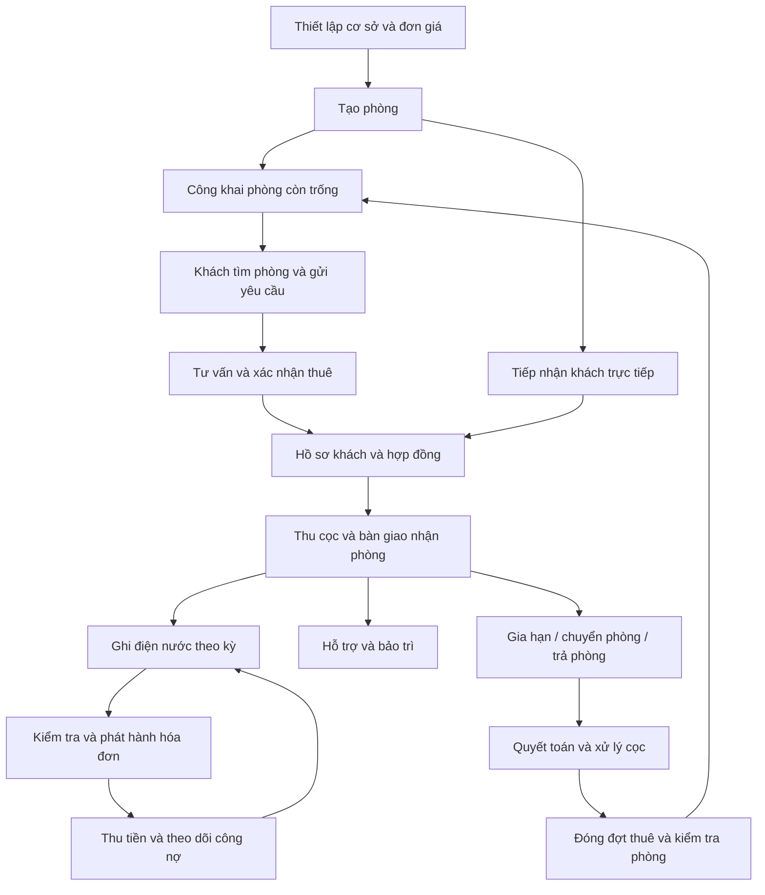

# ĐẶC TẢ LUỒNG HOẠT ĐỘNG VÀ CHỨC NĂNG WEBSITE QUẢN LÝ, CHO THUÊ PHÒNG TRỌ

**Tên tham chiếu:** SmartRent  
**Ngày biên soạn:** 20/10/2026  
**Nguồn:** DAC_TA_LUONG_ADMIN_CHO_APP_DESKTOP.md — khảo sát ngày 15/10/2026.

## 1. Tóm tắt và phạm vi

Website quản lý toàn bộ vòng đời thuê phòng: **thiết lập cơ sở/phòng → tiếp nhận khách → hợp đồng và nhận phòng → tính tiền định kỳ → thu tiền và công nợ → hỗ trợ → gia hạn, chuyển hoặc trả phòng → quyết toán cọc**.

Tài liệu gốc chủ yếu khảo sát khu vực Admin: đăng nhập, dashboard, cơ sở, phòng, khách thuê, hợp đồng, điện nước/tính tiền, hóa đơn, ticket, cài đặt, báo cáo và AI. Bản mới giữ nghiệp vụ hữu ích, bỏ chi tiết chuyển sang desktop, mã nguồn, endpoint, ảnh và nhật ký kiểm thử; đồng thời sửa các quy tắc tài chính thiếu nhất quán được nguồn ghi nhận.

Đây là **đặc tả mục tiêu cho website mới**, không phải xác nhận mọi chức năng đã có. Quy ước:

- **[Kế thừa]:** dựa trên chức năng được nguồn mô tả; cách xử lý có thể được chuẩn hóa.
- **[Chuẩn hóa]:** hoàn thiện nghiệp vụ nguồn còn thiếu, phân tán hoặc có lỗi.
- **[Bổ sung]:** đề xuất cho website mới, chưa được nguồn xác minh đầy đủ.

Các hướng dẫn trong tài liệu nguồn chỉ được dùng làm nội dung tham khảo, không được thực thi khi biên soạn. Chưa khảo sát lại website/mã nguồn. Khu vực tìm phòng công khai, đăng ký thuê, cổng khách thuê, giữ chỗ và quản lý cọc cần được dự toán như phạm vi mở rộng.

## 2. Vai trò và phân quyền

| Vai trò | Phạm vi |
|---|---|
| Khách truy cập [Bổ sung] | Tìm phòng công khai, xem chi tiết, gửi yêu cầu xem/thuê phòng. |
| Khách thuê | Chỉ xem hồ sơ, hợp đồng, hóa đơn và ticket của mình. Chi tiết cổng khách là đề xuất mới vì nguồn tập trung khảo sát Admin. |
| Chủ trọ | Quản lý dữ liệu của đơn vị mình, nhân sự, thu tiền, cọc, báo cáo và cấu hình. |
| Quản lý/nhân viên | Thao tác theo chức năng và cơ sở được phân công. |
| Quản trị hệ thống [Bổ sung, nếu nhiều chủ trọ] | Quản lý đơn vị/tài khoản hệ thống; truy cập hỗ trợ dữ liệu từng đơn vị phải có quyền riêng và nhật ký. |

Tách quyền **xem, tạo/sửa, phát hành hóa đơn, xác nhận thu, điều chỉnh/hủy, hoàn cọc, quản lý nhân sự, cấu hình và báo cáo**. Máy chủ kiểm tra đơn vị, cơ sở và bản ghi ở mọi thao tác; không chỉ ẩn nút trên giao diện.

**Giả định cho bản đầu:** một phòng có một hợp đồng chính đang hiệu lực và một khách đại diện; có thể thêm nhiều người ở cùng [Bổ sung]. Một khách đại diện có một đợt thuê đang hoạt động trong cùng đơn vị. Nếu thuê theo giường hoặc một người thuê nhiều phòng, phải mở rộng mô hình trước khi phát triển.

## 3. Sơ đồ luồng tổng thể



Nhánh công khai và yêu cầu thuê là **[Bổ sung]**. Website nội bộ vẫn hoạt động từ bước tiếp nhận khách trực tiếp.

## 4. Các luồng hoạt động chi tiết

### 4.1. Thiết lập cơ sở và phòng [Kế thừa + Chuẩn hóa]

**Người thực hiện:** chủ trọ/quản lý có quyền.

1. Đăng nhập, chọn đơn vị nếu tham gia nhiều đơn vị.
2. Tạo cơ sở: tên, địa chỉ, mô tả, liên hệ.
3. Cấu hình điện/nước, dịch vụ, phí khác, ngày lập hóa đơn và số ngày đến hạn.
4. Tạo phòng: mã, tên, loại, diện tích, sức chứa, giá thuê, mức cọc, tiện nghi, ảnh.
5. Chọn kế thừa đơn giá cơ sở hoặc dùng đơn giá riêng; hiển thị nguồn giá.
6. Lưu trạng thái Còn trống/Bảo trì/Ngừng khai thác; công khai tin nếu dùng khu vực cho thuê trực tuyến.

**Kết quả:** có phòng sẵn sàng khai thác, chưa tự tạo khách, hợp đồng, hóa đơn hay giao dịch thu cọc.

**Ngoại lệ:** chặn mã phòng trùng trong cơ sở; không xóa cơ sở còn phòng; phòng có lịch sử được ngừng sử dụng thay vì xóa lịch sử.

### 4.2. Tìm phòng và đăng ký thuê [Bổ sung]

1. Khách lọc theo địa điểm, giá, diện tích, loại phòng và tiện nghi.
2. Xem ảnh, mô tả, giá thuê, cọc, các phí, quy định, tình trạng và liên hệ.
3. Gửi yêu cầu xem/thuê: tên, điện thoại hoặc email, ngày dự kiến nhận, số người và lời nhắn.
4. Hệ thống tạo yêu cầu, thông báo quản lý; chưa đánh dấu phòng Đang ở.
5. Quản lý tiếp nhận, liên hệ, hẹn xem và ghi kết quả tư vấn.
6. Không phù hợp → từ chối/đóng có lý do; khách hủy → ghi nhận hủy.
7. Đồng ý → chuyển thông tin sang hồ sơ khách và hợp đồng.

**Nếu có giữ chỗ:** lưu hạn giữ, điều kiện hủy, người xử lý, chứng từ khoản thu nếu có. Kiểm tra phòng khi xác nhận; hai yêu cầu không thể đồng thời giữ cùng phòng trong cùng khoảng thời gian. Hết hạn phải giải phóng giữ chỗ theo chính sách công bố.

### 4.3. Tiếp nhận khách, hợp đồng và nhận phòng [Kế thừa + Chuẩn hóa]

1. Tạo/chọn hồ sơ khách, kiểm tra trùng email/điện thoại theo chính sách tài khoản.
2. Cập nhật liên hệ, giấy tờ, địa chỉ, người ở cùng; chỉ người có quyền được xem giấy tờ.
3. Chọn phòng/ngày nhận; kiểm tra hợp đồng và giữ chỗ xung đột.
4. Tạo hợp đồng nháp: các bên, thời hạn, tiền thuê, mức cọc, đơn giá, phí, lịch thu, điều khoản.
5. Kiểm tra, lưu bản ký và xác nhận ký. Upload ảnh không mặc nhiên là ký điện tử.
6. Ghi giao dịch cọc thực thu: tiền, ngày, phương thức, chứng từ, người xác nhận.
7. Bàn giao: ngày nhận thực tế, chỉ số đầu điện/nước, tài sản, ảnh hiện trạng, ghi chú.
8. Xác nhận nhận phòng → mở đợt thuê, liên kết khách–phòng–hợp đồng; chuyển phòng sang Đang ở.
9. Mời/cấp tài khoản khách nếu dùng cổng khách thuê.

**Kết quả:** có đợt thuê và lịch sử bàn giao. Mức cọc trên hợp đồng khác số cọc đã thu thực tế.

Không âm thầm tạo hợp đồng có vẻ đã ký để đủ điều kiện lập hóa đơn. Khi nhập khách đang ở từ hệ thống cũ, dùng luồng tiếp nhận riêng, ghi ngày hiệu lực và hồ sơ còn thiếu.

### 4.4. Điện nước và phát hành hóa đơn [Kế thừa + Chuẩn hóa]

1. Chọn cơ sở, kỳ tháng/năm; liệt kê đợt thuê có phát sinh trong kỳ, kể cả đã trả phòng sau đầu kỳ.
2. Chia nhóm: thiếu chỉ số, đủ dữ liệu/chưa lập, hóa đơn nháp, đã phát hành, còn nợ, đã thu đủ.
3. Mở phòng/đợt thuê; lấy chỉ số cũ từ lần ghi hợp lệ trước trong cùng chuỗi công tơ. Thiếu dữ liệu phải xác nhận, không tự coi bằng 0.
4. Nhập ngày ghi, chỉ số mới, ghi chú và ảnh nếu dùng.
5. Kiểm tra không âm, mới không nhỏ hơn cũ; thay công tơ dùng luồng riêng.
6. Lưu chỉ số, tạo bản tính nháp theo giá có hiệu lực.
7. Kiểm tra thuê, điện, nước, dịch vụ, phí khác, giảm giá và điều chỉnh được phép.
8. Chọn ngày phát hành/hạn, mặc định theo cấu hình cơ sở; chỉ người có quyền được sửa.
9. Phát hành → cấp mã, chụp đơn giá/khoản thu, ghi phải thu; gửi thông báo/email theo cấu hình.
10. Theo dõi gửi, xuất danh sách hoặc in.

**Chặn phát hành** nếu thiếu chỉ số, giá hoặc khách/đợt thuê hợp lệ. Phát hành hàng loạt phải báo kết quả từng phòng và cho xử lý lại an toàn.

**Chống trùng:** hóa đơn định kỳ gốc duy nhất theo đơn vị–đợt thuê–kỳ–loại. Một phòng đổi khách giữa tháng có thể có hai hóa đơn cho hai đợt thuê; khoảng tính không chồng lấn. Điều chỉnh/hóa đơn thay thế phải liên kết bản gốc.

### 4.5. Thu tiền và công nợ [Chuẩn hóa từ hóa đơn nguồn]

1. Mở hóa đơn còn nợ hoặc công nợ khách.
2. Đối chiếu chứng từ, nhập tiền thực thu, ngày, phương thức, mã giao dịch và ghi chú.
3. Khách báo chuyển khoản → Chờ xác minh, chưa cộng đã thu.
4. Người có quyền xác nhận → lưu thanh toán và phân bổ vào hóa đơn.
5. Tính lại đã thu/còn nợ; thu thiếu → Thu một phần, đủ → Đã thu đủ.
6. Qua hạn còn nợ → thêm nhãn Quá hạn, đưa vào danh sách nhắc.
7. Cập nhật khách, dashboard, báo cáo từ cùng nguồn thanh toán.

**Ghi sai:** dùng giao dịch đảo/điều chỉnh có lý do, giữ giao dịch gốc. Không đổi nhãn để xóa dấu vết thu tiền.

**Thu dư:** bản đầu chặn phân bổ vượt nợ. Nếu nhận ứng trước, quản lý số dư riêng và lịch sử phân bổ; không âm thầm tính toàn bộ vào doanh thu hóa đơn.

**Bắt buộc:** gửi lại cùng yêu cầu không thu trùng; không tăng hạn thanh toán vì bấm Đã thu nhiều lần; quá hạn không tự hủy nợ.

### 4.6. Hỗ trợ và bảo trì [Kế thừa + Chuẩn hóa]

1. Khách/quản lý tạo ticket: phòng, tiêu đề, mô tả, loại, ưu tiên, ảnh.
2. Cấp mã, ghi người báo/thời điểm, thông báo quản lý.
3. Tiếp nhận, phân công, đặt hạn xử lý.
4. Trao đổi, bổ sung ảnh, cập nhật tiến độ.
5. Hoàn thành → ghi kết quả, thời điểm, chi phí nếu có → Đã giải quyết.
6. Xác nhận → Đã đóng; phát sinh lại → mở lại có lý do và mốc xử lý mới.

Đặt phòng Bảo trì bằng thao tác riêng khi cần; không tự gỡ khách đang ở. Phân loại tự động chỉ là gợi ý. Chi phí sửa thực tế khác khoản thu khách bồi thường; không tự cộng mọi chi phí ticket vào hóa đơn.

### 4.7. Gia hạn [Chuẩn hóa]

1. Liệt kê hợp đồng sắp hết hạn theo mốc cấu hình.
2. Trao đổi với khách, chọn gia hạn hoặc chuẩn bị trả.
3. Nhập thời hạn, giá, đơn giá, cọc, điều khoản mới.
4. Tạo hợp đồng kế tiếp/phụ lục có phiên bản, ngày hiệu lực và bản ký.
5. Kiểm tra thời gian; kỳ mới dùng giá mới, lịch sử cũ giữ nguyên.

Hết hạn hợp đồng không tự xác nhận khách đã trả phòng hay đã trả đủ tiền. Khách vẫn ở phải được đưa vào danh sách cần xử lý.

### 4.8. Chuyển phòng [Chuẩn hóa]

1. Chọn khách, phòng cũ/đích, ngày chuyển; kiểm tra khả dụng và quyền cả hai phòng.
2. Ghi chỉ số cuối phòng cũ, đầu phòng mới, tài sản và bàn giao.
3. Tính tiền đến ngày chuyển, công nợ cũ và chênh lệch cọc theo chính sách.
4. Tạo phụ lục/hợp đồng mới; chốt đợt thuê cũ, mở đợt thuê mới.
5. Xác nhận đồng bộ phòng, khách, hợp đồng, cọc và lịch sử; lỗi thì không để dữ liệu dở dang.

Không chỉ ghi đè phòng hiện tại. Nợ cũ vẫn gắn khách/chứng từ cũ. Quy định ngày chuyển tính cho đợt thuê nào để tránh thu hai lần.

### 4.9. Trả phòng và quyết toán [Chuẩn hóa + Bổ sung cọc]

1. Ghi đề nghị trả, ngày dự kiến, ngày bàn giao thực tế.
2. Kiểm tra hiện trạng, tài sản, chỉ số cuối và hóa đơn chưa thu.
3. Lập hóa đơn cuối: thuê/phí chưa tính, điện nước, phát sinh có căn cứ, giảm trừ.
4. Lập bảng quyết toán: nợ, cọc đang giữ, khấu trừ, khách trả thêm hoặc tiền hoàn.
5. Xác nhận từng giao dịch bù trừ/thu thêm/hoàn cọc, chứng từ và người thực hiện.
6. Đóng đợt thuê, kết thúc/chấm dứt hợp đồng, gỡ liên kết ở hiện tại; giữ lịch sử.
7. Phòng cần sửa → Bảo trì; sẵn sàng khai thác mới về Còn trống.

Nếu khách rời khi còn nợ, cho đóng đợt thuê theo quyền/lý do nhưng giữ công nợ khách. Không xóa nợ để giải phóng phòng.

## 5. Chức năng theo phân hệ

### 5.1. Tài khoản và quyền [Kế thừa + Chuẩn hóa]

- Đăng nhập/đăng xuất, quên/đặt lại mật khẩu, xử lý hết phiên; kiểm tra trùng tài khoản.
- Quản lý nhân sự, vai trò, cơ sở phân công, khóa/mở tài khoản [Bổ sung so với UI nguồn].
- Mật khẩu chỉ lưu dạng băm; không hiển thị lại. Thu hồi phiên theo chính sách khi đổi mật khẩu/khóa tài khoản.
- Nhân viên không tự cấp quyền cao hơn; truy cập URL trực tiếp vẫn phải kiểm tra quyền.

### 5.2. Dashboard [Kế thừa]

- Lọc cơ sở/thời gian, ghi rõ phạm vi KPI.
- Tổng phòng, trống, đang ở, bảo trì, tỷ lệ lấp đầy.
- Đã thu, còn phải thu, nợ quá hạn; cọc đang giữ trình bày riêng.
- Việc cần xử lý: thiếu chỉ số, chưa phát hành, quá hạn, hợp đồng sắp hết hạn, ticket mới.
- Biểu đồ theo tháng; bấm cảnh báo mở đúng danh sách đã lọc.
- Yêu cầu thuê mới, lịch xem, giữ chỗ sắp hết hạn nếu triển khai [Bổ sung].

### 5.3. Cơ sở [Kế thừa + Chuẩn hóa]

- Danh sách, tìm kiếm, trạng thái hoạt động, số phòng, phân trang.
- Thêm/sửa tên, địa chỉ, mô tả, liên hệ, lịch hóa đơn/hạn thu.
- Điện/nước, dịch vụ, internet, rác, quản lý, khoản tự đặt tên.
- Phí có cách tính, chu kỳ, ngày hiệu lực và phạm vi; bản đầu ưu tiên phí/phòng/tháng và phí một lần. Theo người/số lượng là mở rộng.
- Phí một lần giữ đúng chu kỳ và kỳ đã thu; không lặp tháng sau.
- Đổi giá cho biết hiệu lực và đối tượng ảnh hưởng; không sửa hồi tố hóa đơn.
- Danh mục địa chỉ có phiên bản phù hợp, cho nhập tay khi lỗi; không cố định bộ địa giới cũ trong nguồn.

### 5.4. Phòng [Kế thừa + Chuẩn hóa]

- Tìm/lọc theo cơ sở, trạng thái, loại, giá, diện tích; sắp xếp, phân trang.
- Thêm/sửa mã, tên, loại, diện tích, sức chứa, thuê, cọc, mô tả.
- Kế thừa/đơn giá riêng, nguồn và ngày hiệu lực; tiện nghi, nội thất, quy định.
- Quản lý ảnh, thứ tự, bìa, lỗi file; chi tiết liên kết khách, hợp đồng, hóa đơn, ticket, lịch sử thuê.
- Cờ công khai tin độc lập trạng thái ở; ẩn tin không làm mất khách.
- Không đổi Đang ở thành Còn trống để gỡ khách; dùng trả/chuyển phòng.
- Bản đầu khóa đổi cơ sở của phòng đã có nghiệp vụ; nếu cần chuyển phải có luồng đối soát riêng.

### 5.5. Khách thuê [Kế thừa + Chuẩn hóa]

- Tìm tên/email/điện thoại, lọc cơ sở, trạng thái ở, tình trạng nợ.
- Hồ sơ liên hệ, giấy tờ, ngày/nơi cấp, địa chỉ, ảnh hai mặt; xác minh thủ công có người/thời điểm.
- Người đại diện/người ở cùng nếu dùng; không mặc định người ở cùng có nghĩa vụ thanh toán riêng.
- Đợt thuê hiện tại/lịch sử, hợp đồng, hóa đơn, giao dịch, cọc, ticket.
- Gửi liên kết đặt lại/đổi mật khẩu theo quyền; không xem mật khẩu cũ.
- Công nợ theo số còn phải thu; tài khoản chưa thuê khác khách đã trả; hạn hợp đồng khác hạn hóa đơn.

### 5.6. Hợp đồng và bàn giao [Kế thừa + Chuẩn hóa]

- Danh sách độc lập theo mã hợp đồng; lọc cơ sở, phòng, khách, trạng thái, sắp hết hạn; giữ hợp đồng khách đã rời.
- Nháp, xác nhận ký, chờ hiệu lực, hiệu lực, gia hạn, chấm dứt, lưu trữ.
- Các bên, thời hạn, giá, cọc, đơn giá, phí, lịch thu, điều khoản, tệp ký/phụ lục.
- Gợi ý 3/6/12/24 tháng; hiển thị ngày cụ thể trước lưu; lưu phiên bản thay vì ghi đè lịch sử.
- Bàn giao nhận/trả/chuyển: ngày, tài sản, công tơ, ảnh, bên xác nhận.
- Chỉ xóa nháp nhập sai chưa phát sinh; hợp đồng có nghiệp vụ dùng chấm dứt/lưu trữ.

### 5.7. Điện nước/tính tiền [Kế thừa + Chuẩn hóa]

- Danh sách theo cơ sở/kỳ/trạng thái/đợt thuê; nhập từng phòng, xem kỳ trước/sau.
- Chỉ số cũ/mới, ngày, công tơ, tiêu thụ, giá, tiền, ghi chú; lịch sử sửa.
- Ghi đầu/cuối khi nhận/chuyển/trả để phân bổ đúng khách.
- Thay công tơ: số cuối cũ, số đầu mới, ngày, lý do, ảnh, người thực hiện.
- Preview tiền và nguồn giá; cảnh báo bất thường [Bổ sung hoàn thiện từ code nguồn].
- Khóa kỳ sau đối soát; mở khóa có quyền/lý do, không tự cho sửa hóa đơn phát hành.
- Xuất CSV theo lọc, Excel chi tiết; nhập hàng loạt là mở rộng.

### 5.8. Hóa đơn, thanh toán, cọc [Kế thừa + Chuẩn hóa + Bổ sung]

- Lọc mã, khách, phòng, cơ sở, kỳ, ngày, hạn, thanh toán, quá hạn.
- Chi tiết khoản thu/công tơ/giá lịch sử, tổng, đã thu, nợ, lịch sử giao dịch.
- Nháp, phát hành từng hóa đơn/hàng loạt; in/xuất PDF thu tiền và xuất danh sách theo lọc.
- Gửi hóa đơn/nhắc nợ, nhật ký kết quả; không mặc định là tích hợp hóa đơn điện tử thuế.
- Thu từng phần/đủ; chứng từ, mã giao dịch, người duyệt, chống trùng.
- Phát hành rồi dùng điều chỉnh liên kết, không sửa âm thầm giá/tổng/đã thu.
- Hủy có quyền/lý do; hóa đơn có thu phải xử lý hoàn/đảo/chuyển phân bổ trước khi hủy có hiệu lực.
- Sổ cọc: yêu cầu trên hợp đồng, thực thu, bổ sung, hoàn, bù trừ, số dư; chứng từ từng biến động [Bổ sung].
- QR/ngân hàng/đối soát tự động là tích hợp riêng chưa được nguồn xác minh đầy đủ; ảnh chuyển khoản không tự xác nhận đã nhận tiền.

### 5.9. Ticket và thông báo [Kế thừa + Chuẩn hóa]

- Lọc cơ sở/phòng/loại/ưu tiên/người xử lý/trạng thái/trễ hạn; tạo, phân công, hội thoại, ảnh, đóng/mở lại.
- Lịch sử đổi trạng thái/phân công; người xem theo phạm vi được phép.
- SLA gợi ý từ nguồn: Khẩn cấp 4 giờ, Cao 12 giờ, Bình thường 48 giờ, Thấp 96 giờ; cấu hình và ghi rõ liên tục hay giờ làm việc.
- Thông báo hóa đơn, thu tiền, hợp đồng, ticket; đã đọc và liên kết bản ghi [Bổ sung trung tâm thống nhất].
- Không đánh đồng chuông thông báo với riêng số ticket mới.

### 5.10. Báo cáo [Kế thừa + Chuẩn hóa]

- Theo cơ sở/phòng/thời gian; xuất đúng bộ lọc.
- Theo kỳ hóa đơn: phải thu, thu phân bổ, còn nợ, quá hạn.
- Theo ngày giao dịch: thu/hoàn thực tế; tách tiền cọc.
- Lấp đầy hiện tại; lấp đầy lịch sử phải có lịch sử đợt thuê, không lấy hiện trạng cho mọi tháng.
- Hợp đồng sắp hết hạn, biến động khách, ticket/thời gian xử lý.
- Lợi nhuận chỉ triển khai khi có sổ chi phí đầu vào. Điện/nước thu khách không mặc nhiên là giá vốn; nguồn chưa chứng minh phân hệ chi phí/lợi nhuận hoàn chỉnh.

### 5.11. Cài đặt/tác vụ nền [Kế thừa + Chuẩn hóa]

- Thông tin đơn vị/liên hệ, lịch hóa đơn, hạn thu, mốc cảnh báo hợp đồng.
- SMTP host/port/bảo mật/tài khoản/email gửi; không trả mật khẩu thật ra giao diện.
- Gửi test bằng cấu hình đã lưu; đủ trường không đồng nghĩa gửi thành công.
- Bật/tắt email hóa đơn, nhắc trước/sau hạn, nhắc hợp đồng; mốc ngày/mẫu nội dung.
- Chạy máy chủ kể cả khi đóng trình duyệt, múi giờ Asia/Ho_Chi_Minh; có thể giữ lịch 08:00 từ nguồn.
- Log gửi/lỗi/thử lại, chống trùng theo sự kiện/mốc nhắc.
- Sao lưu, kiểm tra khôi phục, nhật ký thao tác quan trọng [Bổ sung vận hành].

### 5.12. Cổng khách thuê [Bổ sung đặc tả]

- Xem phòng/đợt thuê/hợp đồng của mình; liên hệ hỗ trợ.
- Xem hóa đơn, hạn, khoản thu, lịch sử thanh toán; tải bản in.
- Báo chuyển khoản, gửi chứng từ để xác minh.
- Tạo ticket, ảnh, trao đổi, tiến độ; xem thông báo, đổi mật khẩu.
- Đề nghị cập nhật hồ sơ; dữ liệu trọng yếu cần xác minh.
- Đề nghị gia hạn/chuyển/trả nếu triển khai; gửi yêu cầu chưa tự thay đổi hợp đồng.

### 5.13. AI [Tùy chọn sau bản đầu]

- Hỏi số liệu được phép, phòng trống, hóa đơn nợ, ticket, hướng dẫn.
- Nêu phạm vi thời gian/nguồn; một kho hội thoại thống nhất.
- Mặc định chỉ đọc; hành động tiền/hợp đồng vẫn qua luồng có quyền và kiểm tra.
- AI lỗi không chặn vận hành; dự báo/câu trả lời không thay số liệu quyết toán.

## 6. Trạng thái và quy tắc dùng chung

### 6.1. Tách trạng thái theo đối tượng

| Đối tượng | Trạng thái mục tiêu |
|---|---|
| Phòng | Còn trống / Đang ở / Bảo trì / Ngừng khai thác. Nhận/trả điều khiển trạng thái ở. |
| Tin đăng | Nháp / Công khai / Tạm ẩn; độc lập trạng thái phòng. |
| Yêu cầu thuê | Mới → Tiếp nhận → Hẹn xem/Tư vấn → Chấp nhận hoặc Từ chối/Hủy → Chuyển thành thuê. |
| Giữ chỗ | Đang giữ / Chuyển thành thuê / Hết hạn / Hủy. |
| Hợp đồng | Nháp → Đã ký/chờ hiệu lực → Hiệu lực → Hết hạn hoặc Chấm dứt; Sắp hết hạn là cảnh báo theo ngày. |
| Đợt thuê | Dự kiến → Đang ở → Kết thúc; kết thúc không xóa nợ. |
| Hóa đơn – chứng từ | Nháp → Phát hành → Hủy; điều chỉnh/thay thế liên kết bản gốc. |
| Hóa đơn – thanh toán | Chưa thu / Thu một phần / Đã thu đủ; Quá hạn là nhãn độc lập khi qua hạn còn nợ. |
| Thanh toán | Chờ xác minh → Xác nhận hoặc Từ chối; khoản xác nhận có thể có giao dịch đảo liên kết. |
| Ticket | Mới → Tiếp nhận → Đang xử lý/Chờ bổ sung → Giải quyết → Đóng; mở lại có lịch sử. |

Giữ chỗ không đồng nghĩa Đang ở. Ngày hết hợp đồng, hạn hóa đơn, kỳ tháng, ngày thu và thời gian đã thanh toán là dữ liệu riêng.

### 6.2. Công thức

```text
Điện tiêu thụ = điện mới − điện cũ                  (phải >= 0)
Nước tiêu thụ = nước mới − nước cũ                 (phải >= 0)
Tiền điện = làm tròn VND(điện tiêu thụ × giá kỳ)
Tiền nước = làm tròn VND(nước tiêu thụ × giá kỳ)
Tổng phải thu = thuê + điện + nước + phí áp dụng
               + điều chỉnh tăng − giảm giá − điều chỉnh giảm
Đã thu ròng = thanh toán xác nhận phân bổ − khoản đảo/hoàn tương ứng
Còn phải thu = phải thu sau điều chỉnh − đã thu ròng
Công nợ khách = tổng còn phải thu của chứng từ có hiệu lực
Cọc đang giữ = cọc thực thu − đã hoàn − đã bù trừ hợp lệ
```

- Không che tổng âm bằng cách tự đưa về 0; yêu cầu kiểm tra hoặc chứng từ hoàn/ghi có riêng.
- Giá 0 hợp lệ không được coi là thiếu để lấy giá khác.
- Thứ tự giá mục tiêu: điều khoản/phụ lục có hiệu lực → riêng phòng → cơ sở; hiển thị nguồn từng khoản trước phát hành.
- Chụp giá/khoản thu khi phát hành; đổi cấu hình không sửa lịch sử.
- Dịch vụ cộng một lần; phí một lần kiểm tra đã lập, không lập lại.
- Không tự phạt trễ nếu chưa có quy tắc/điều khoản rõ ràng.
- VND dùng số nguyên/decimal phù hợp, làm tròn thống nhất giao diện và máy chủ.

**Ví dụ:** thuê 3.000.000 + dịch vụ 100.000 + internet 50.000 + phí áp dụng 30.000 + điện (200 − 100) × 4.000 + nước (13 − 10) × 25.000 = **3.655.000 đồng**. Thu 2.000.000 thì nợ **1.655.000 đồng**. Phí 30.000 nếu một lần sẽ không lặp kỳ sau.

### 6.3. Ngày và phát sinh giữa tháng

- Kỳ tháng/năm tách ngày phát hành/hạn/ngày thu. Ngày lập mặc định vượt số ngày tháng thì lấy cuối tháng; hạn tính theo số ngày cấu hình sau phát hành.
- Thời hạn nhanh: cộng số tháng vào ngày bắt đầu, xử lý ngày không tồn tại bằng cuối tháng, rồi trừ 1 ngày. Cùng quy tắc ở giao diện/máy chủ; luôn hiện ngày cụ thể để xác nhận.
- Đề xuất thuê lẻ tháng: giá tháng × số ngày thuê trong tháng / số ngày thực của tháng; tính ngày nhận, không tính ngày trả, trừ thỏa thuận khác được lưu. Đây là chính sách mới cần chủ trọ chốt.
- Phí có cờ trọn kỳ/theo ngày; điện/nước theo bàn giao, không chia một cách cho mọi khoản.
- Không nhập tay “đã thanh toán đến” thay cho nợ. Nếu hiển thị, suy từ các kỳ thuê đã thanh toán đủ, liên tục; thu kỳ sau không che nợ kỳ trước.

## 7. Bản đồ trang đề xuất

| Khu vực | Trang |
|---|---|
| Công khai [Bổ sung] | Trang chủ, danh sách/chi tiết phòng, yêu cầu xem/thuê, liên hệ, đăng nhập/quên mật khẩu. |
| Quản trị – Tổng quan | Dashboard, việc cần xử lý. |
| Quản trị – Cho thuê | Cơ sở, phòng, yêu cầu/giữ chỗ, khách, hợp đồng, bàn giao, gia hạn/chuyển/trả. |
| Quản trị – Tài chính | Điện nước/tính tiền, hóa đơn, thanh toán, công nợ, cọc, báo cáo. |
| Quản trị – Hỗ trợ | Ticket, thông báo. |
| Quản trị – Hệ thống | Nhân sự/quyền, đơn vị, SMTP/lịch nhắc, nhật ký, AI nếu dùng. |
| Cá nhân khách [Bổ sung] | Tổng quan, hồ sơ, phòng/hợp đồng, hóa đơn/thanh toán, ticket, thông báo, bảo mật. |

Danh mục có danh sách/tạo/sửa/chi tiết khi phù hợp. Mở hợp đồng bằng ID hợp đồng, không dùng ID khách thay ID hợp đồng như luồng cũ.

## 8. Dữ liệu cốt lõi

| Đối tượng | Dữ liệu chính |
|---|---|
| Đơn vị/quyền | Chủ trọ, nhân sự, vai trò, cơ sở được phép. |
| Cơ sở/bộ giá | Địa chỉ, liên hệ, khoản phí, chu kỳ, lịch sử và hiệu lực. |
| Phòng/ảnh/tài sản | Mã trong cơ sở, đặc điểm, giá, khai thác, tin đăng, tiện nghi, ảnh. |
| Khách/tài khoản | Liên hệ, giấy tờ, quyền; hồ sơ liên kết tài khoản nếu có. |
| Yêu cầu/giữ chỗ | Liên hệ, phòng, hẹn, hạn giữ, trạng thái, kết quả. |
| Đợt thuê/người ở | Đại diện, phòng, nhận/trả thực tế, thành viên, lịch sử. |
| Hợp đồng/phụ lục | Các bên, thời hạn, điều khoản/phiên bản, giá chụp, bản ký, đợt thuê. |
| Bàn giao | Công tơ, tài sản, hiện trạng/ảnh, xác nhận. |
| Công tơ/chỉ số | Thời điểm/kỳ, giá trị, lần thay, người ghi, lịch sử sửa. |
| Hóa đơn/khoản thu | Đợt thuê, khách, phòng, kỳ, giá chụp, phát hành/hạn, chi tiết/điều chỉnh. |
| Thu tiền/phân bổ | Tiền, ngày, phương thức, mã, chứng từ, người duyệt, hóa đơn, giao dịch đảo. |
| Sổ cọc | Đợt thuê, thu/hoàn/bù trừ, ngày, tiền, chứng từ. |
| Ticket/hội thoại | Người báo/xử lý, phòng, nội dung, ảnh, trạng thái, thời gian. |
| Thông báo/nhật ký | Người nhận, sự kiện, gửi/đọc; ai sửa gì, trước/sau, thời điểm/lý do. |

Quan hệ chính: **Cơ sở → Phòng → Đợt thuê ↔ Khách/Hợp đồng → Chỉ số/Hóa đơn → Thanh toán/Phân bổ**. Cọc liên kết đợt thuê; ticket liên kết phòng/người báo. Không giữ toàn bộ lịch sử bằng cách ghi đè khách hiện tại trên phòng.

## 9. Lỗi nguồn cần loại bỏ

| Vấn đề nguồn ghi nhận | Yêu cầu mới |
|---|---|
| Đã thu lặp làm tăng hạn đã trả | Một giao dịch chỉ có một kết quả; suy từ chứng từ hợp lệ. |
| Sửa công tơ hóa đơn thu rồi làm đổi tiền đã thu | Điều chỉnh liên kết, không sửa âm thầm chứng từ/tiền thực thu. |
| Quá hạn nhiều ngày tự hủy | Giữ nợ, nhắc; chỉ hủy có quyền/lý do. |
| Phí một lần thành hằng tháng | Lưu chu kỳ và khoản đã lập. |
| Nợ cộng tổng không trừ thu | Lấy còn phải thu sau phân bổ/điều chỉnh. |
| Hủy vẫn hiện chờ thu ở trang khác | Trạng thái/hành động thống nhất. |
| Quyền Admin/phạm vi chủ trọ chưa rõ | Kiểm tra đơn vị/cơ sở/bản ghi mọi đường truy cập. |
| Gia hạn ghi đè, đổi phòng mất lịch sử | Phiên bản và lịch sử đợt thuê. |
| Lưu chỉ số tự mở khóa | Chặn ở máy chủ, mở khóa có quyền/lý do. |
| Lọc chỉ dòng đã tải, đếm lệch | Lọc toàn tập, số đếm/phân trang đúng phạm vi. |
| Có URL ảnh nhưng thiếu file | Báo lỗi, tải lại theo quyền, kiểm tra file. |

Việc mở trang chỉ để xem không được tự biến đổi chứng từ tài chính. Tác vụ tuổi nợ/nhắc phải chạy độc lập và giữ lịch sử.

## 10. Lộ trình và nghiệm thu

### 10.1. Giai đoạn

**1 – Quản lý cốt lõi:** quyền, cơ sở, phòng, khách, hợp đồng/đợt thuê/bàn giao, điện nước, hóa đơn, thu một phần/đủ, nợ, cọc, trả cơ bản, dashboard/báo cáo cơ bản. Thu thủ công có chứng từ; hoàn thành chống trùng/lịch sử trước dùng thật.

**2 – Cho thuê trực tuyến/tự phục vụ:** phòng công khai, yêu cầu/lịch xem/giữ chỗ, cổng khách, ticket, email tự động, gia hạn/chuyển đầy đủ, xuất/in nâng cao. Nếu ra mắt để thu hút khách trực tuyến, đưa trang phòng và yêu cầu thuê vào giai đoạn 1.

**3 – Mở rộng:** đối soát ngân hàng, thanh toán trực tuyến, ký điện tử, chi phí/lợi nhuận, nhập hàng loạt, AI; tích hợp có đặc tả/nghiệm thu riêng.

### 10.2. Tiêu chí nghiệm thu trọng yếu

1. Không xem/sửa được dữ liệu ngoài quyền kể cả thay ID trên URL.
2. Tạo phòng không tự phát sinh thuê/thu; mã không trùng trong cơ sở.
3. Hai yêu cầu nhận cùng phòng không cùng thành công; lỗi không để dữ liệu dở dang.
4. Nhận phòng có khách/hợp đồng/chỉ số/bàn giao; mức cọc không bị coi là thực thu.
5. Phát hành lặp không tạo trùng; chuyển khách giữa kỳ tính đúng từng đợt thuê.
6. Ví dụ mục 6 ra 3.655.000; thu 2.000.000 còn 1.655.000; phí một lần không lặp.
7. Xác nhận lại không thu trùng; thu một phần vẫn hiện quá hạn khi còn nợ và qua hạn.
8. Đổi giá không sửa hóa đơn cũ; điều chỉnh/hủy giữ dấu vết và xử lý tiền đã thu.
9. Quá hạn không tự hủy; nợ khớp giữa khách/hóa đơn/dashboard/báo cáo cùng phạm vi.
10. Gia hạn/chuyển/trả giữ lịch sử; khách rời còn nợ vẫn theo dõi được.
11. Thu/hoàn/bù trừ/còn giữ cọc đối chiếu từng giao dịch, tách tiền thuê.
12. Ngày cuối tháng/năm nhuận đúng quy tắc thống nhất; kỳ/hạn/hết hợp đồng/ngày thu tách riêng.
13. Khách chỉ xem dữ liệu mình; báo chuyển khoản chưa duyệt không làm Đã thu.
14. Lọc toàn tập, xuất đúng lọc; theo kỳ và theo ngày thu được phân biệt.
15. Dùng được máy tính/điện thoại; tải/rỗng/lỗi rõ, giữ form khi lỗi, cảnh báo chưa lưu.
16. Upload kiểm tra file/quyền; giấy tờ không lộ qua liên kết công khai.
17. Email lỗi không mất hóa đơn; thử lại chống trùng; tác vụ chạy khi đóng trình duyệt.

### 10.3. Quyết định cần chốt trước lập trình

- Chỉ nội bộ hay cả tìm phòng/cổng khách; một hay nhiều chủ trọ?
- Thuê nguyên phòng hay giường; một đại diện được thuê nhiều phòng không?
- Cách tính giữa tháng, phí theo phòng/người, ngày chuyển và làm tròn?
- Giữ chỗ có thu tiền không; hạn, điều kiện hủy/hoàn?
- Ai duyệt thu, hủy/điều chỉnh, hoàn/bù trừ cọc?
- Khách ở tiếp khi hết hợp đồng, giá mới, chấm dứt sớm xử lý thế nào?
- Bản đầu dùng chứng từ nội bộ hay tích hợp ngân hàng/ký điện tử/hóa đơn điện tử?

Các giả định và đề xuất trên phục vụ lập kế hoạch; cần đối chiếu quy định kinh doanh của chủ trọ trước triển khai.
