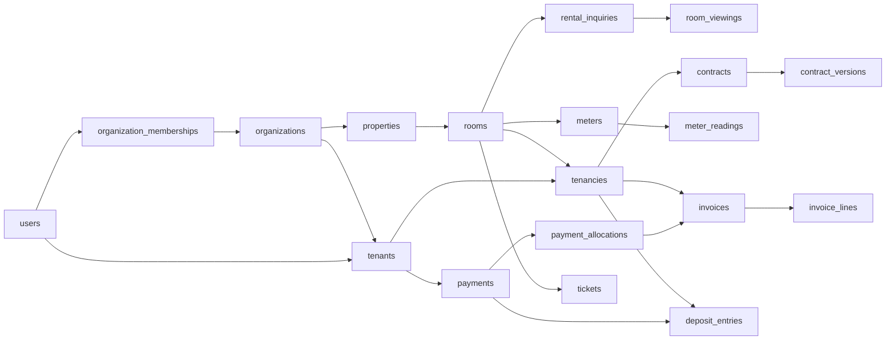
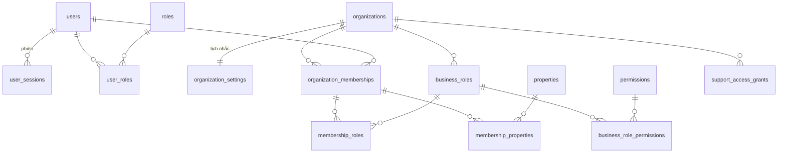
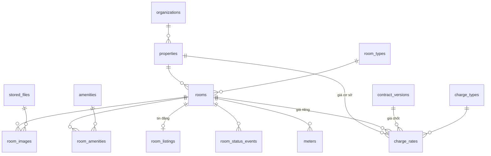
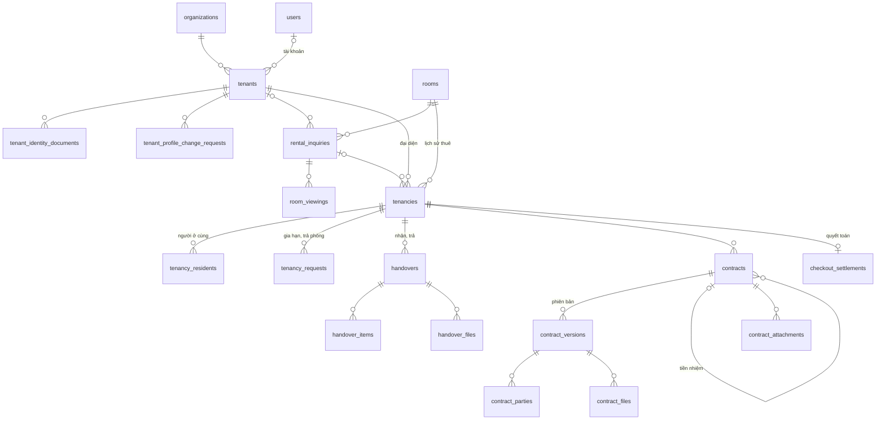
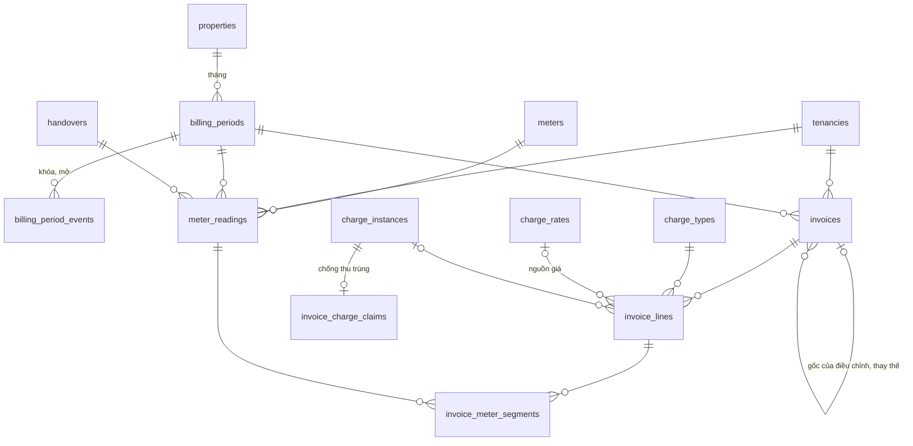
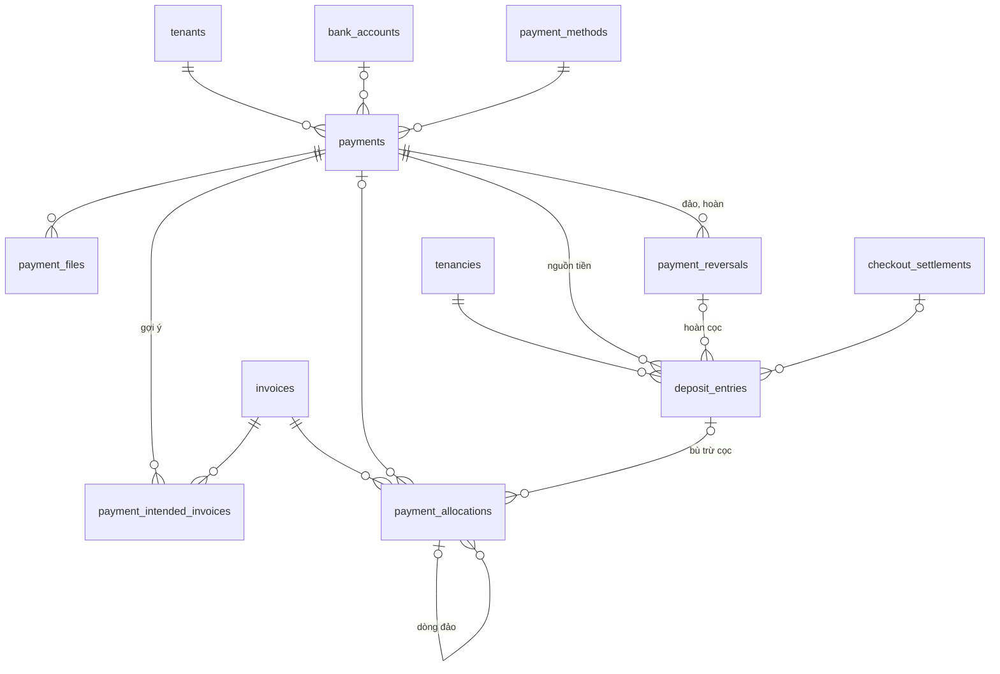
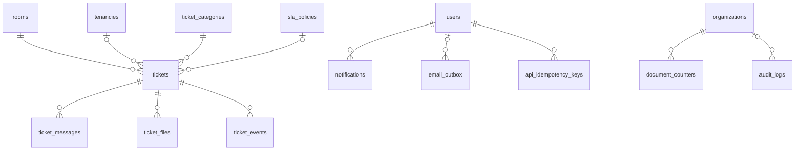

# Sơ đồ quan hệ SmartRent

74 bảng, 168 khóa ngoại. Sơ đồ chia theo phân hệ, chỉ ghi cột khóa và cột đặc trưng; cột đầy đủ xem [từ điển dữ liệu](TU_DIEN_DU_LIEU.md).

## Tổng thể

## Tài khoản, đơn vị, phân quyền

## Cơ sở, phòng, tin đăng

## Khách, xem phòng, đợt thuê, hợp đồng

## Tính tiền và hóa đơn

## Thu tiền và cọc

## Ticket, thông báo, vận hành

