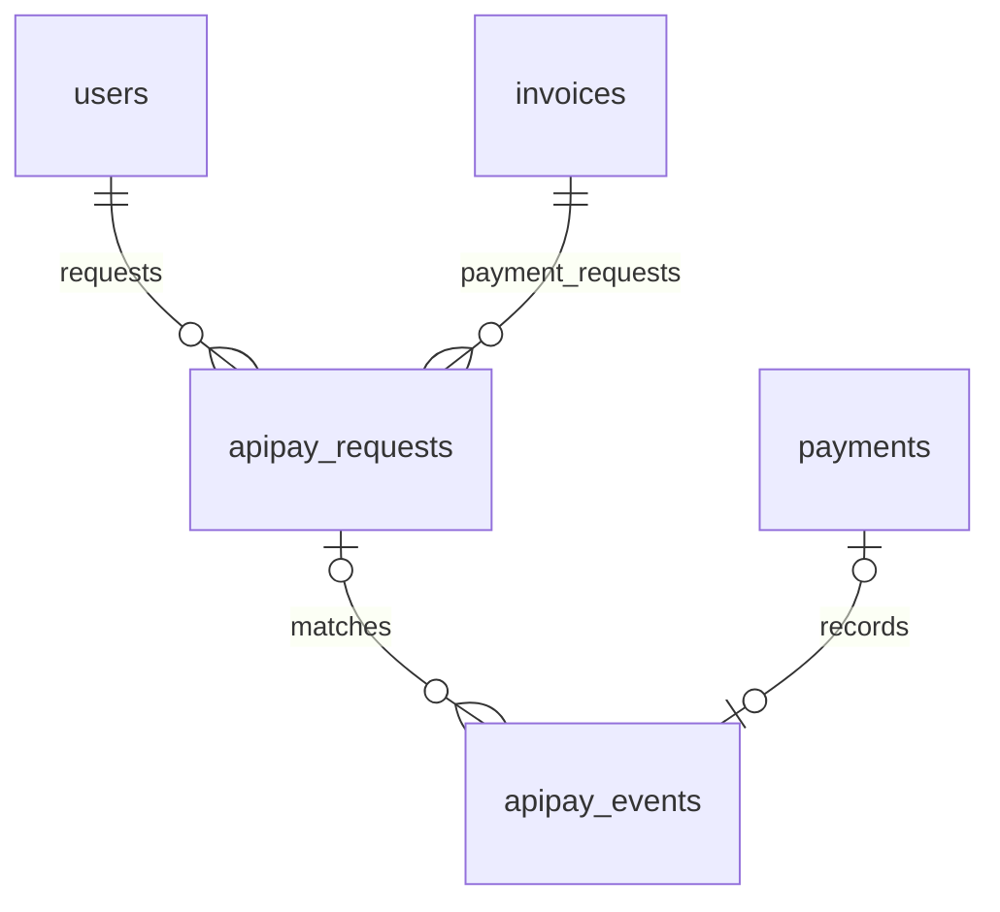
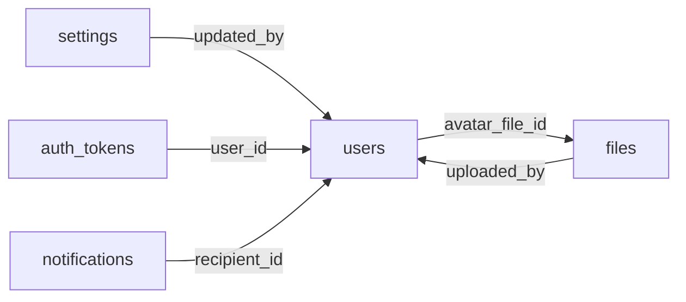
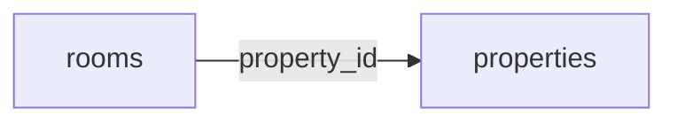
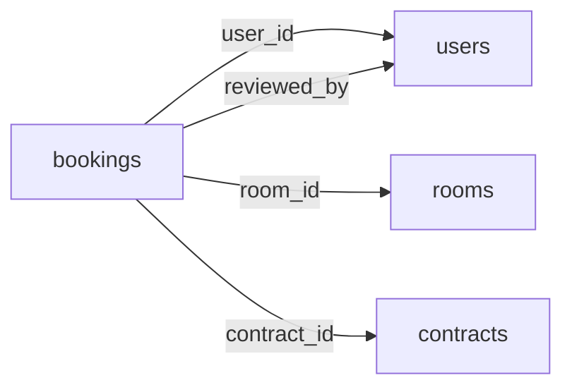
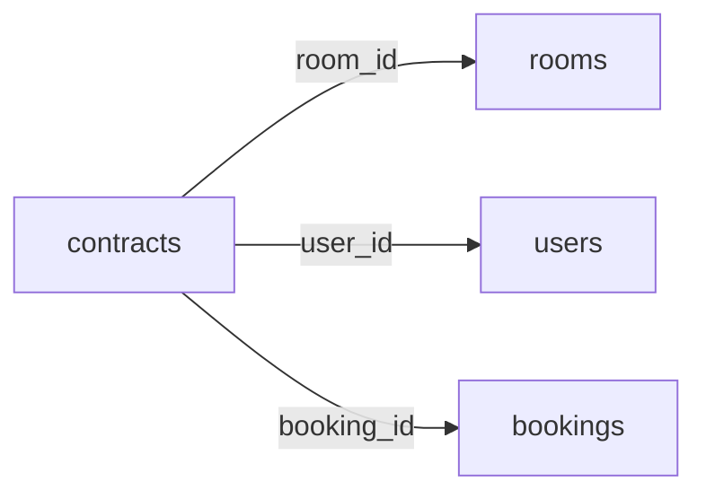
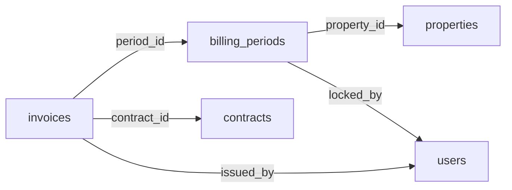
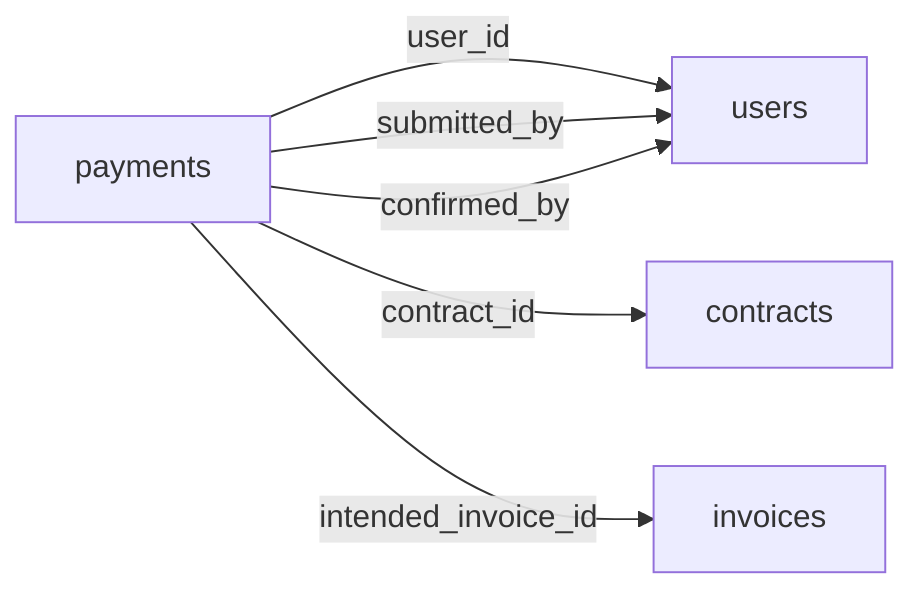
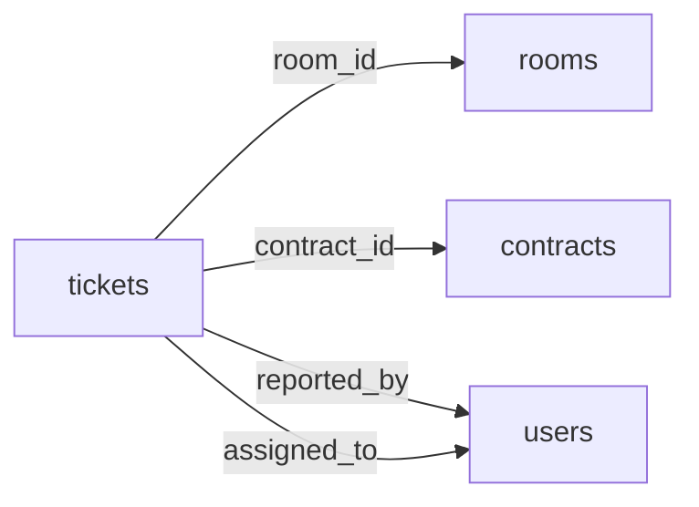

# Sơ đồ database — 13 bảng nghiệp vụ + 2 bảng ApiPay

`apipay_requests` lưu mã nội dung/QR cho hóa đơn; `apipay_events` lưu webhook đã xác minh, khóa duy nhất `transaction_id`. Chỉ worker đối soát thành công mới ghi `payments`. Chi tiết schema và trạng thái: [`14_apipay.sql`](14_apipay.sql), [hướng dẫn ApiPay](../docs/APIPAY.md). Các sơ đồ bên dưới mô tả 13 bảng nghiệp vụ giữ nguyên.

Một admin và các user. Dữ liệu lặp đã gộp thành JSONB trong bảng chính; xem JSON_DATA.md để biết cấu trúc. Đường nối dưới đây là khóa ngoại cột; các ID bên trong JSONB được trigger kiểm tra, không phải khóa ngoại tự động của PostgreSQL.

## Tài khoản và dùng chung

| Bảng | Dùng cho |
|---|---|
| `users` | Tài khoản và toàn bộ hồ sơ khách, kể cả khách chưa kích hoạt đăng nhập. |
| `auth_tokens` | Phiên đăng nhập, đặt lại mật khẩu và lời mời; chỉ lưu hash token. |
| `files` | Metadata tệp dùng chung; nội dung nhị phân ở storage. |
| `settings` | Cấu hình thương hiệu, lịch nhắc và ngân hàng mặc định. |
| `notifications` | Thông báo và trạng thái đọc theo tài khoản. |

## Cơ sở, phòng và giá

| Bảng | Dùng cho |
|---|---|
| `properties` | Cơ sở, danh mục tiện ích và bảng giá mặc định dạng JSONB. |
| `rooms` | Phòng cùng tin đăng, tiện ích, ảnh, giá riêng và lịch sử trạng thái. |

## Lịch xem và đề nghị

| Bảng | Dùng cho |
|---|---|
| `bookings` | Yêu cầu, lịch xem, giữ chỗ và đề nghị của khách, phân biệt bằng kind. |

## Thuê và hợp đồng

| Bảng | Dùng cho |
|---|---|
| `contracts` | Một hồ sơ thuê và hợp đồng; chứa gia hạn, bản ký, người ở cùng, bàn giao. |

## Điện nước và hóa đơn

| Bảng | Dùng cho |
|---|---|
| `billing_periods` | Kỳ tháng theo cơ sở và trạng thái khóa, kể cả tháng chưa có hóa đơn. |
| `invoices` | Hóa đơn cùng chỉ số điện nước, lịch sử sửa số và toàn bộ dòng tính tiền. |

## Thanh toán và tiền cọc

| Bảng | Dùng cho |
|---|---|
| `payments` | Sổ thanh toán và cọc; phân bổ vào hóa đơn nằm trong JSONB. |

## Hỗ trợ

| Bảng | Dùng cho |
|---|---|
| `tickets` | Sự cố cùng loại, tệp, hội thoại và tiến độ trong một bảng. |

