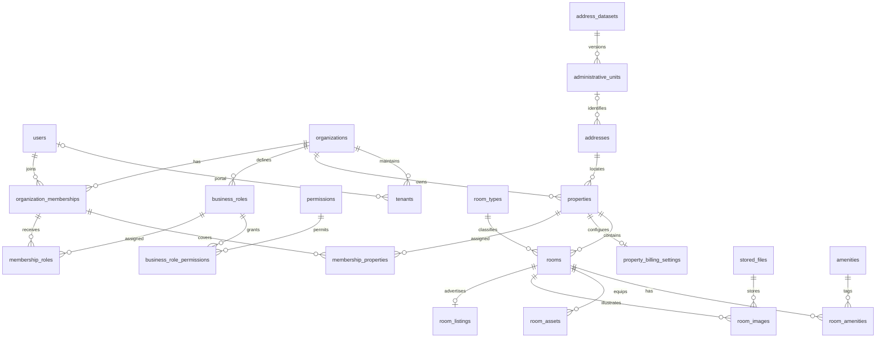
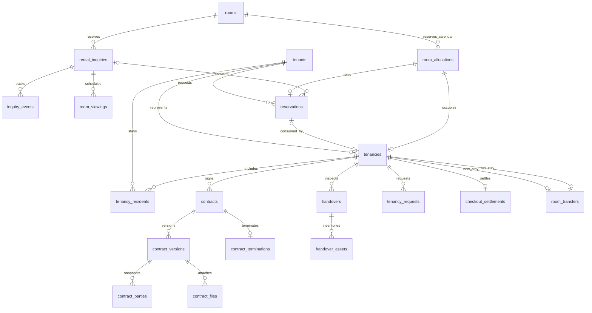
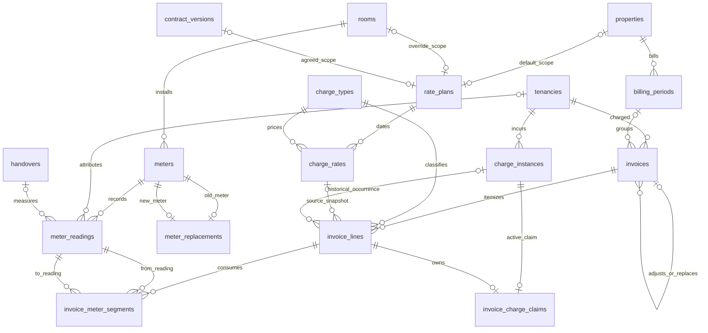
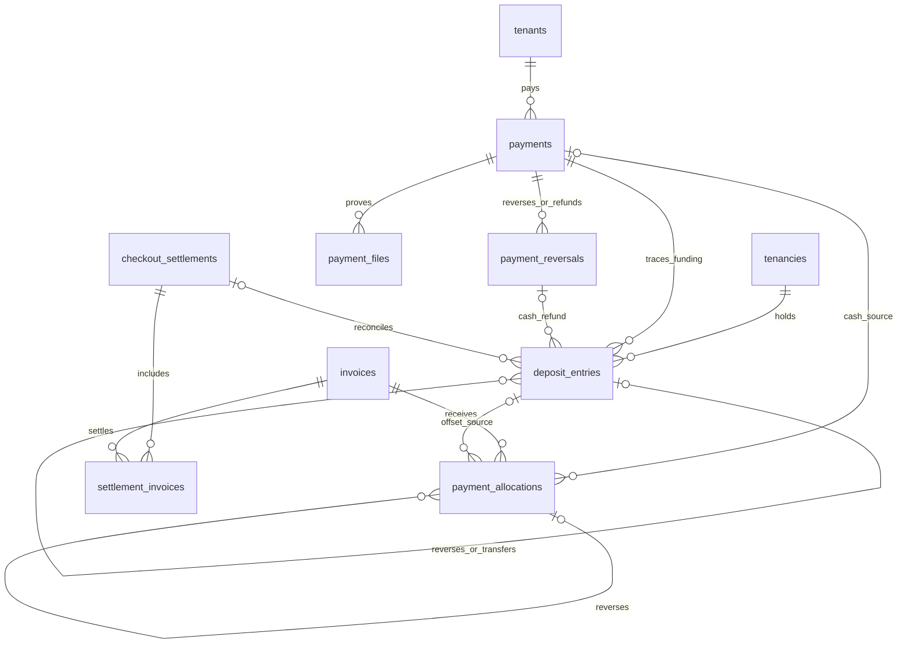
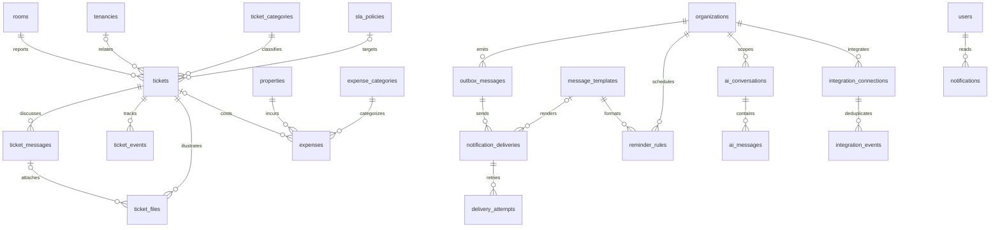

# Sơ đồ quan hệ SmartRent

Các hình dưới chia theo nghiệp vụ để dễ đọc. Tất cả 226 FK thực tế, bao gồm file/người thao tác, được liệt kê trong [từ điển dữ liệu](TU_DIEN_DU_LIEU.md). `||` là một, `o|` là không hoặc một, `o{` là nhiều tùy chọn.

## Đơn vị, tài khoản và phòng

## Yêu cầu, giữ chỗ và vòng đời thuê

## Giá, công tơ và chứng từ

Mỗi rate plan bắt buộc đúng một scope; không phải đồng thời có cả ba quan hệ. Mỗi claim chỉ một dòng còn hiệu lực, nhưng một occurrence có thể được giữ trên các dòng lịch sử đã hủy.

## Tiền, cọc và quyết toán

Payment allocation bắt buộc đúng một nguồn `payment_id` hoặc `deposit_entry_id`. Cọc hoàn có cash refund tương ứng; cọc bù trừ có phân bổ tương ứng. Các cặp được kiểm tra khi commit.

## Hỗ trợ và thông báo

